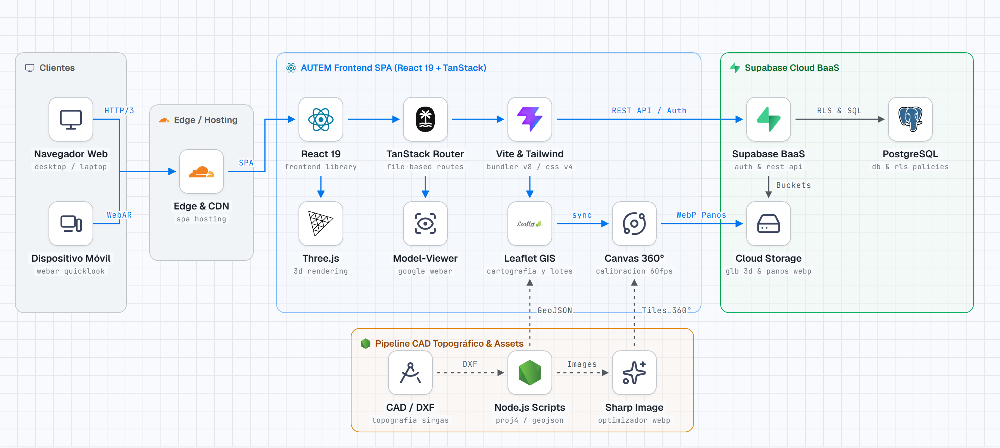
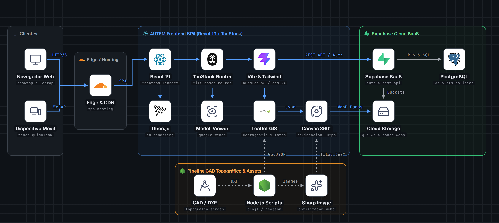
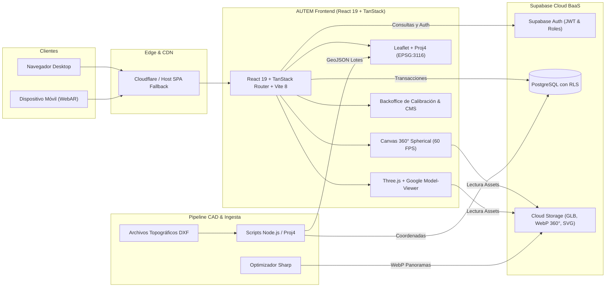

<div align="center">

# AUTEM — Real Estate & Visualización Arquitectónica de Vanguardia

<p align="center">
  <strong>Plataforma inmobiliaria inmersiva de alto nivel con modelos 3D interactivos, recorridos en realidad aumentada (WebAR), cartografía GIS y calibración esférica de planos sobre fotografía aérea 360°.</strong>
</p>

<p align="center">
  
</p>

[](https://react.dev/)
[](https://www.typescriptlang.org/)
[](https://tanstack.com/router)
[](https://vitejs.dev/)
[](https://tailwindcss.com/)
[](https://threejs.org/)
[](https://modelviewer.dev/)
[](https://supabase.com/)
[](https://www.postgresql.org/)

---

</div>

## Descripción General

**AUTEM** es una solución tecnológica integral diseñada para el desarrollo, comercialización y gestión de proyectos inmobiliarios campestres y urbanísticos exclusivos. Fusiona un diseño editorial sofisticado con motores gráficos de última generación, permitiendo a clientes, inversores y administradores:

- Explorar terrenos y lotes con exactitud milimétrica sobre fotografías aéreas en 360°.
- Recorrer villas y propiedades arquitectónicas a escala real en 3D y Realidad Aumentada (WebAR) sin instalar aplicaciones nativas.
- Georreferenciar parcelas y amenidades mediante cartografía GIS sincronizada con levantamientos topográficos reales en coordenadas CAD (Magna-Sirgas).
- Administrar el catálogo, contenidos, cotizaciones y calibraciones espaciales desde un panel de control privado y seguro.

---

## Arquitectura del Sistema

El ecosistema está desacoplado en una arquitectura modular de alta fidelidad compuesta por **Frontend Inmersivo (SPA)**, **Backend en la Nube (Supabase BaaS)**, **Pipeline de Ingesta Topográfica CAD** y una capa global de **Edge & CDN**:

<p align="center">
  
  
</p>

<p align="center"><em>Diagrama de infraestructura generado con especificación oficial de arquitectura de ingeniería.</em></p>

### Flujo de Interacción y Servicios



---

## Funcionalidades y Módulos Principales

### 1. Visor Panorámico 360° y Calibración Equirrectangular
- **Superposición Vectorial en Tiempo Real**: Renderizado en canvas HTML5 a 60 FPS mediante proyección esférica y matriz de rotación yaw/pitch/roll.
- **Calibración Intuitiva de Terrenos**:
  - **Modo Todo el Plano (340 Lotes)**: Ajuste en bloque de escala, rumbo, inclinación y deriva angular sin deformar la geometría urbanística.
  - **Modo Por Pedazos**: Selección táctil en pantalla de bloques contiguos o hileras de lotes para adaptarlos a las curvas y desniveles del terreno.
  - **Modo Solo Lote**: Microajuste individual de coordenadas para encaje perfecto.
- **HUD Flotante Táctil**: Control Pad con pasos de precisión (`0.1°`, `0.5°`, `2.0°`), rotación y zoom integrado directamente sobre la vista panorámica.
- **Arrastre Fluido con Puntero / Touch**: Soporte `setPointerCapture` con respuesta instantánea libre de latencia.

### 2. 3D Inmersivo y Realidad Aumentada (WebAR)
- **Three.js**: Visualizador interactivo 3D con iluminación basada en imagen (IBL), control de órbita y sombras proyectadas.
- **Google Model-Viewer**: Acceso directo a WebAR en smartphones:
  - **iOS**: Apple AR Quick Look nativo (`.usdz` / `.glb`).
  - **Android**: Google Scene Viewer nativo.
  - Sin necesidad de descargar aplicaciones de la App Store o Google Play.

### 3. Motor Cartográfico & Topografía GIS
- **Sincronización CAD Real**: Conversión de coordenadas geodésicas oficiales del sistema **Magna-Sirgas / Colombia Origen Único (EPSG:3116)** a coordenadas geográficas globales (WGS84).
- **Cartografía Interactiva**: Integración de Leaflet con rotación de mapa (`leaflet-rotate`), capas vectoriales de lotes, zonificación, vías, lagos y amenidades.
- **Cotizador Dinámico de Lotes**: Selección de parcelas con estado de disponibilidad en tiempo real, cálculo de metraje cuadrado y cotización instantánea.

### 4. Backend & Seguridad (Supabase Cloud BaaS)
- **PostgreSQL 16**: Esquemas relacionales con migraciones versionadas para proyectos, lotes, galerías, contenidos del sitio y metadatos de calibración de dron.
- **Row Level Security (RLS) Endurecido**: Políticas de acceso granular que garantizan lectura pública optimizada y mutaciones restringidas únicamente a personal autenticado con roles de administración.
- **Supabase Auth**: Sesiones persistentes basadas en tokens JWT y perfiles administrativos protegidos.
- **Supabase Storage**: CDN global para la entrega eficiente de modelos 3D (`.glb`), imágenes panorámicas de alta densidad en WebP y planos vectoriales.

### 5. Backoffice Administrativo (/admin)
- **Gestor Editorial**: Administración visual de portadas, textos, llamadas a la acción e imágenes del home.
- **Calibrador 360°**: Entorno gráfico especializado para alinear los levantamientos CAD con las tomas de dron.
- **Inventario y Disponibilidad**: Control del estado de venta de cada unidad (disponible, reservado, vendido).

---

## Stack Tecnológico Detallado

| Capa | Tecnologías | Propósito |
| :--- | :--- | :--- |
| **Frontend Core** | React 19, TypeScript 5.8 | Arquitectura de componentes tipada y reactiva |
| **Routing & SSR** | TanStack Router, TanStack Start | Enrutamiento basado en archivos con type-safety de extremo a extremo |
| **Bundler & Build** | Vite 8, Rolldown engine | Compilación ultrarrápida, HMR instantáneo y optimización de assets |
| **Estilos & UI** | Tailwind CSS v4, Radix UI, Lucide Icons | Sistema de diseño de alta precisión con glassmorphism |
| **Motores 3D & AR** | Three.js, `@google/model-viewer` | Renderizado WebGL y Realidad Aumentada móvil |
| **Panoramas 360°** | Photo Sphere Viewer, Custom 2D Canvas | Proyección equirrectangular esférica a 60 FPS |
| **Cartografía & GIS** | Leaflet, React Leaflet, Proj4 | Geoprocesamiento y visualización de planos topográficos |
| **Backend & Base de Datos** | Supabase, PostgreSQL 16 | BaaS, base de datos relacional, Auth y Storage |
| **Seguridad** | PostgreSQL RLS (Row Level Security) | Protección de datos a nivel de fila |
| **Pipeline CAD & Ingesta** | Node.js, Sharp, DXF Tools | Procesamiento de planos CAD y compresión de texturas WebP |
| **Hosting & Edge** | GitHub Pages / Cloudflare | Despliegue estático global con fallback SPA `404.html` |

---

## Estructura del Repositorio

```text
AUTEM/
├── .agents/skills/             # Habilidades de IA y herramientas de arquitectura (stack-diagram)
├── cad/                        # Archivos fuente de topografía y planos (.dxf)
├── docs/                       # Documentación técnica y diagramas de arquitectura
│   └── architecture/           # Fuentes y renders del diagrama de arquitectura
├── public/                     # Archivos estáticos servidos públicamente
│   ├── images/                 # Renders, texturas y assets del proyecto
│   ├── models/                 # Modelos 3D (.glb / .gltf) y recursos WebAR
│   └── panoramas/              # Tiles y metadatos de fotos 360° equirrectangulares
├── scripts/                    # Pipeline de automatización y procesamiento
│   ├── extract-villa-paraiso-navigation.mjs  # Extractor de vías y lotes desde DXF
│   ├── project-lots-to-panorama.mjs         # Proyección matemática de lotes a 360°
│   ├── build-panorama-from-3dvista.mjs      # Empaquetador de tiles panorámicos
│   ├── optimize-home-images.mjs             # Compresor de imágenes con Sharp
│   └── create-spa-fallback.mjs              # Generador de fallback 404 para GitHub Pages
├── src/
│   ├── components/             # Componentes modulares
│   │   ├── ar/                 # Visualizador de Realidad Aumentada
│   │   ├── catalog/            # Catálogo interactivo de lotes y propiedades
│   │   ├── home/               # Hero, carrusel y secciones editoriales
│   │   ├── layout/             # Shell, navegación y pie de página
│   │   └── project-view/       # Visor 360°, mapas y panel de controles
│   ├── features/
│   │   └── panorama-360/       # Motor de renderizado en canvas y proyecciones
│   ├── routes/                 # Enrutamiento basado en archivos (TanStack Router)
│   │   ├── index.tsx           # Portal principal
│   │   ├── catalogo.tsx        # Explorador de propiedades
│   │   ├── proyecto/$slug.tsx  # Vista inmersiva del desarrollo
│   │   └── admin/              # Módulos de administración y calibración
│   └── lib/                    # Clientes de API, Supabase y utilidades geodésicas
├── supabase/                   # Configuración del Backend
│   └── migrations/             # Migraciones SQL versionadas y políticas RLS
├── package.json
└── vite.config.ts
```

---

## Instalación y Puesta en Marcha

### Prerrequisitos
- **Node.js**: v20 o superior
- **Gestor de paquetes**: `npm`, `pnpm` o `bun`

### 1. Clonar el repositorio
```bash
git clone https://github.com/Naiker12/AUTEM.git
cd AUTEM
```

### 2. Configurar variables de entorno
Crea un archivo `.env.local` basado en `.env.example`:
```bash
VITE_SUPABASE_URL=https://tu-proyecto.supabase.co
VITE_SUPABASE_ANON_KEY=tu-clave-anonima-publica
```

### 3. Instalar dependencias
```bash
npm install
```

### 4. Iniciar el servidor local
```bash
npm run dev
```
La aplicación estará disponible de forma predeterminada en `http://localhost:5173`.

---

## Scripts y Comandos Disponibles

| Comando | Descripción |
| :--- | :--- |
| `npm run dev` | Inicia el servidor de desarrollo Vite con TanStack Router. |
| `npm run build` | Compila la aplicación para producción y genera el fallback `404.html`. |
| `npm run preview` | Previsualiza el build de producción localmente. |
| `npm run typecheck` | Ejecuta la verificación estricta de tipos de TypeScript (`tsc --noEmit`). |
| `npm run lint` | Analiza el código fuente con ESLint. |
| `npm run format` | Da formato a todo el código con Prettier. |
| `npm run navigation:extract` | Extrae polígonos y rutas desde archivos CAD `.dxf` a GeoJSON. |
| `npm run panorama:project` | Proyecta matemáticamente los vértices de los lotes sobre el panorama 360°. |
| `npm run images:home` | Optimiza las imágenes del home mediante Sharp (conversión WebP). |

---

## Licencia y Derechos

Desarrollado para **AUTEM — Real Estate & Visualización Arquitectónica**.  
Todos los derechos reservados © 2026.
